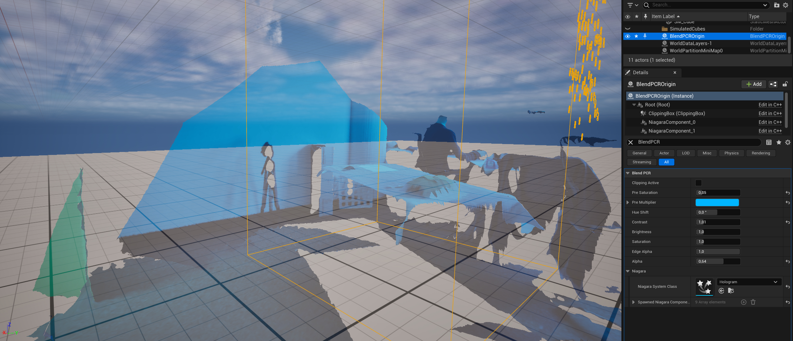
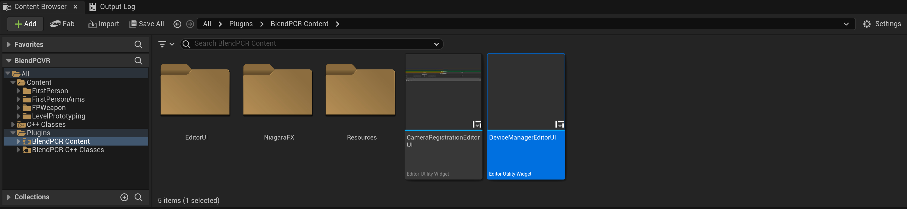
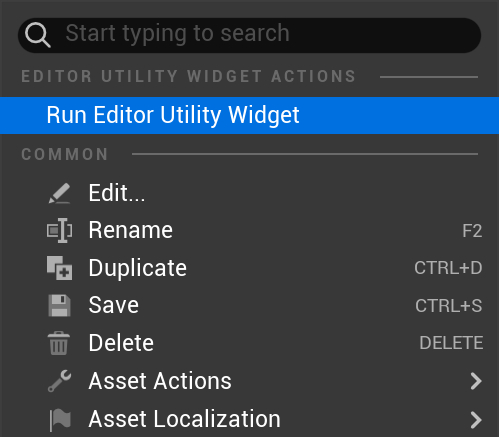
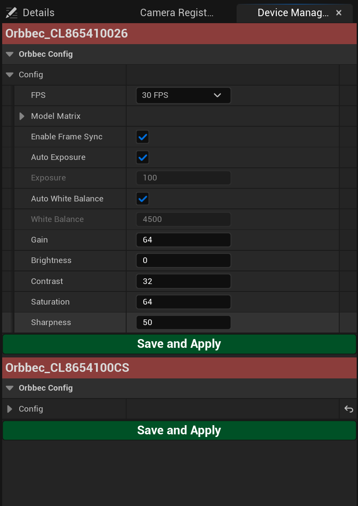
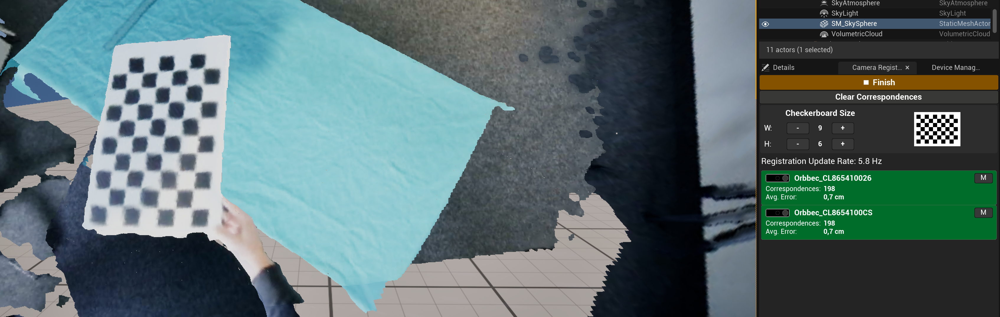

# BlendPCR UE5 Suite

> **Note:** The project was made public upon request and is provided as-is.

This is a personal **Unreal Engine 5.4** project for real-time **BlendPCR** rendering using multiple **Microsoft Azure Kinect** and **Orbbec Femto** depth cameras, including mixed-camera setups.

BlendPCR has been reimplemented natively in Unreal Engine using the **Render Dependency Graph (RDG)** and **HLSL**. As such, its behavior may differ slightly from the original implementation. 

This project is primarily an **experimental playground and has not been polished or prepared for public release**. However, it may still be useful to others working on similar setups. Theoretically, the rendering implementation should be able to work with up to 8 cameras; however, the USB-connectivity most times restrict this to 3-4 live cameras. If you want to use BlendPCR with up to 8 cameras, you could implement an `InputDevice` for network streaming by yourself, see the code at app/Plugins/BlendPCR/Source/BlendPCR/Public/InputDevice - there, the Orbbec and Azure Kinect devices are also implemented.

**Platform support:** Currently, only Windows is supported out of the box, particularly for camera registration.

## BlendPCROrigin



The `BlendPCROrigin` is the main actor and must be placed **exactly once** in the scene, regardless of the number of cameras.

It controls the settings of the View Extension responsible for BlendPCR rendering, including color adjustments, saturation, and simple visual effects (e.g., hologram-like rendering). For standard rendering, reset these settings to their default values.

**Clipping:** When `Clipping Active` is enabled, only geometry within the `ClippingBox` component (outlined in yellow) is rendered. The box can be freely transformed relative to the `BlendPCROrigin` to define the visible region.

**Niagara effects:** Additional Niagara System classes can be assigned to create effects such as holographic beams. However, the lifecycle management of spawned Niagara components is not fully implemented. You may need to update the assigned Niagara class directly in the spawned components.

## Device Configuration

Two **Editor Utility Widgets** are provided for device configuration and camera calibration. Both can be found in the plugin's `BlendPCR Content` folder.



Right-click the desired widget and select **Run Editor Utility Widget** to open its interface in the Unreal Editor.



The **Device Manager** allows you to configure Microsoft Azure Kinect and Orbbec Femto Bolt cameras, including device connections, exposure, and color settings.

If I remember correctly, hardware synchronization via a 3.5 mm sync cable is implemented for Azure Kinect cameras, but not yet for Orbbec Femto devices. Make sure your **Orbbec Femto Bolt** cameras are properly configured, including running the **[metadata script](https://github.com/orbbec/OrbbecSDK/blob/main/misc/scripts/obsensor_metadata_win10.md)**. Otherwise, timestamps may be incorrect, resulting in significant latency.



## Extrinsic Camera Calibration (Registration)

Camera registration uses **OpenCV checkerboard detection** to identify corresponding points across cameras. Detected checkerboard corners are reprojected into 3D using depth measurements.

The registration pipeline consists of:

1. **Checkerboard detection:** Detect inner checkerboard corners and reproject them into 3D.
2. **Pairwise registration:** Estimate rigid transformations between camera pairs using SVD-based transformation estimation.
3. **Global optimization:** Optimize the pairwise transformations using **g2o pose-graph optimization**.

Currently, pairwise transformations are **not weighted** during global optimization, which leaves considerable room for improvement.

### Calibration Workflow

Open the **Camera Registration** Editor Utility Widget and select the correct checkerboard dimensions. The specified values represent the number of **inner corners**, not squares. A preview displays the selected checkerboard pattern.

1. Start calibration and move the checkerboard through the cameras' overlapping fields of view. At least two cameras must see the checkerboard simultaneously.
2. Cameras currently detecting the checkerboard are highlighted in **green**.
3. Try to collect a similar number of correspondences across all cameras, with comparable checkerboard coverage. Since pairwise transformations are currently unweighted, balanced observations are particularly important.
4. Once the registration looks satisfactory, click **Finish**.
5. If the result is incorrect or visibly misaligned, click **Clear Correspondences** and repeat the process.

The calibration pipeline is still experimental and its accuracy depends on the camera arrangement and overlapping fields of view. Nevertheless, it most times provided sufficiently accurate results in my own setups with up to four cameras.



**Important:** Make sure that both `PoseSolver.exe` (located in `app\Binaries\Win64\posegraph`) and the Unreal Engine application are allowed through your firewall. Otherwise, the UI (green in the image above) will remain gray even when you move the checkerboard within the camera's field of view.
For troubleshooting purposes, you can temporarily disable your firewall to check whether it is causing the issue. Re-enable it afterward.

### Pose-Graph Solver

Due to the assumed effort of integrating g2o directly into Unreal Engine's build process, pose-graph optimization runs in a **separate executable**.

On Windows, Unreal Engine automatically launches:

`app/Binaries/Win64/posegraph/PoseSolver.exe` (because of this, never delete the Binary folder!)

The solver communicates over the network with the Unreal Engine application, which computes the pairwise transformations internally.

The relevant implementation can be found in:

- `BlendPCR/Public/Registration/cameraRegistrator.h`
- `utils/posegraph`

**Linux:** Camera registration is not supported out of the box. To use it on Linux, the pose-graph solver must be compiled from `utils/posegraph` and launched separately, or integrated into the Unreal Engine project's startup process.

## Known Limitations

- The project is experimental and not production-ready.
- Out-of-the-box support is limited to Windows.
- Camera registration may require multiple attempts, depending on the setup.
- Pose-graph optimization does not currently weight pairwise transformations.
- Niagara component lifecycle management is incomplete.
- BlendPCR rendering may differ from the original implementation; some artifacts at the view border of the cameras remain visible.


## Cite
This work is an Unreal Engine reimplementation of BlendPCR. If you use this code, please cite the original paper:
```
@inproceedings{10.2312:egve.20241366,
    booktitle = {ICAT-EGVE 2024 - International Conference on Artificial Reality and Telexistence and Eurographics Symposium on Virtual Environments},
    editor = {Hasegawa, Shoichi and Sakata, Nobuchika and Sundstedt, Veronica},
    title = {{BlendPCR: Seamless and Efficient Rendering of Dynamic Point Clouds captured by Multiple RGB-D Cameras}},
    author = {Mühlenbrock, Andre and Weller, Rene and Zachmann, Gabriel},
    year = {2024},
    publisher = {The Eurographics Association},
    ISSN = {1727-530X},
    ISBN = {978-3-03868-245-5},
    DOI = {10.2312/egve.20241366}
}
```